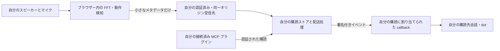

# 自分用の Sonic Assistant Bridge を作る

[English](build-your-own.md) · [プロジェクト README](../README.ja.md)

このコードを再利用し、音響的な動きのメタデータを**自分のアシスタント環境**へ接続できます。ローカル測定・プレビュー・模擬受信は利用できますが、認証付きの実配送は開発中の構成です。稼働中の共用サービスや、設定済みの dot 接続を配布するものではありません。ホスト選定前に[現在の接続状況](private-connection.md)を確認してください。

共有するのはコードとイベント形式です。受信先、検証済みの利用者識別、プラグイン、購読、callback、署名用秘密は、それぞれ自分の構成で用意します。このリポジトリは KG-NINJA の非公開エンドポイント、Site ID、ユーザー ID、callback、資格情報を共用するためのものではありません。

## 1. まずローカルのデモを試す

Node.js 22 以降と npm を用意し、取得したソースのディレクトリで実行します。

```sh
npm ci
npm start
```

`http://127.0.0.1:8765` を開き、**デモを開始**を選びます。マイク・発音・アカウント・API キーは不要です。開発用 UI は日本語で、静的ビルドには英語も含みます。`npm run demo:bridge` でも、一時的なループバック受信先を使ってイベントを試せます。アシスタントには接続しません。

ローカル模擬受信は `BRIDGE_RECEIVER=1 npm start` で起動し、画面の「04」で送信先を選んで明示的に有効化します。PowerShell では `$env:BRIDGE_RECEIVER='1'` を設定してから `npm start` を実行します。これは模擬受信であり、dot の購読は作りません。

実際の測定は**マイクで測定を開始**を押し、ブラウザーの許可に基づいて行います。初期値は高周波音 20 kHz・デジタル振幅 2%、上限 3% です。音圧や安全性の保証値ではないため、聞こえる・不快な場合は停止してください。**停止**、タブの非表示、ページ離脱で測定を終了し、自動開始・自動再開しません。イベント送信は初期無効で、送信専用の停止操作もあります。

## 2. 音声処理をブラウザー内に留める



図は非公開配備の設計で、実サービスの稼働を示していません。公開 Pages には受信バックエンドがなく、別の人の非公開サイトへ POST しません。実配送には、自分の非公開サイトの測定画面を開き、そのサイトと同じオリジンの受信先を使います。

[`src/bridge.js`](../src/bridge.js) のバージョン付き JSON 形式に含めるのは次の情報だけです。

| フィールド | 意味 |
| --- | --- |
| `schemaVersion`、`source` | バージョン `1`。センサーの名称は引き続き `sonic-forcefield`。 |
| `id`、`sessionId`、`sequence`、`occurredAt` | 一時的なイベント・セッション ID、連番、UTC の発生時刻。 |
| `mode` | `live`、または模擬と明示した `synthetic`。 |
| `type`、`state`、`reason` | セッションの開始・停止、または動きの候補と定義済みの理由。 |
| `score` | 開始・停止では `null`。動きでは dB 値、単位、基準との差／減衰の区別。 |

公開されているバリデーター／スキーマを使い、生音声・FFT 配列・文字起こし・自由文・利用者の身元・送信先 URL を追加しないでください。スコアは確率でも距離でもありません。日時だけでも活動時間の手掛かりになります。「動きなし」は不在の証明ではなく、検知しても人物や静止した人の在席は確定しません。物理的な精度は機器・環境に依存し、この構成では未検証です。

## 3. 自分の非公開構成を用意する

1. 自分の構成について、非公開の利用対象、ホスト、サインイン方法、保存先・保存期間、送信経路を決めます。リソース・接続・購読・秘密・有料サービスを作る前に、該当する所有者の許可を得てください。提供元の現在の料金と制限も確認します。この手順は無料のホスティングや運用を保証しません。
2. 測定画面と API の両方を認証します。サーバーの `{siteId, userId}` は検証済みの身元から決め、イベント JSON、URL パラメーター、利用者が自由に設定するヘッダーから取得しません。マイク許可、サイトへのログイン、プラグインへのアクセス、イベント購読、ホスティング費用は別々の権限です。
3. 所有者ごとに分離し、原子的に更新できる永続ストアを実装します。署名用秘密は暗号化してサーバーだけに保持します。期限・解除・重複・連発制限に加え、複数 Worker にまたがる解除と送信開始の整合も必要です。試験用メモリーストアのフラグを変えても本番用にはなりません。
4. 自分の固定 HTTPS オリジンで、測定 UI と `/api/bridge/*` を配信します。`data-private-bridge="true"` は認証済みの非公開 HTML にだけ付けます。これは操作を表示するための印で、認証の代わりにはなりません。ループバック試験用の印や、認証を迂回するトークンをブラウザーへ配布しないでください。`npm start` には非公開 API を取り付けていません。
5. **自分の**認証済み MCP サーバーを**自分の**プラグインに接続します。`sonic.motion` を発見できることを確認し、自分の会話への購読を要求して、渡された callback の検証後に配送を有効にします。callback URL と署名用秘密は認証された購読手続きから受け取り、dot の URL を推測したり他人の購読をコピーしたりしません。公式手続きは `events/list`、`events/subscribe`、`events/unsubscribe` を使います。[OpenAI MCP Events](https://developers.openai.com/plugins/build/mcp-events)

非公開 UI は**認証と購読を確認する**を押したときだけ状態を確認します。認証・購読・配送準備が整っても、送信を明示的に有効にするまでは送りません。**送信を無効にする**はこのページの送信を止め、**購読を解除する**は別の操作で購読を削除します。非表示・ページ離脱では進行中の処理を中断し、背景で再送しません。中断した書き込みが既にサーバーへ届いている可能性があるため、結果不明の操作を無条件に再実行しません。

## 4. Node と Sites の違いを扱う

認証済み Node ホストでは、次のように組み合わせます。**実行可能なデプロイスクリプトではなく構成例です。** 認証・永続ストア・HTTPS ホスト・非公開 HTML の配信と、利用するフレームワークの `Request`／`Response` 接続処理を別途実装する必要があります。

```js
import { createEventService } from './bridge/service.js';
import { createPinnedCallbackTransport } from './bridge/https-callback.js';
import { createPrivateBridgeHandler } from './bridge/private-handler.js';

const service = createEventService({
  store: yourVerifiedDurableStore,
  transport: createPinnedCallbackTransport(),
});
const handle = createPrivateBridgeHandler({
  siteOrigin: yourVerifiedHttpsOrigin,
  service,
  authenticate: verifyYourOwnSession,
});
// verifyYourOwnSession は検証済みの { siteId, userId } または null を返す。
// handle を所定の非公開ルートへ接続する。未検証の身元ヘッダーは使わない。
```

Node 用配送処理は接続のたびに DNS 応答を確認し、許可した公開 IPv4 へ接続を固定しつつ TLS のホスト名検証を維持します。転送、非公開アドレス、IPv6 や混在する応答は拒否します。callback と互換性がない場合、同等の保護を備える経路ができるまで配送を無効のままにしてください。

**Sites** では自分に返された Site の識別情報、非公開の利用対象、プラグインだけを使います。Sites 用アダプターが身元ヘッダーを信頼できるのは Sites Dispatch の後段だけで、公開 Node サーバーへそのまま取り付けると偽装されます。Node 用配送コードは Sites Worker の実装ではありません。DNS の事前検査と通常の `fetch` だけでは接続時の IP 保護を証明できず、`resolveOverride` も任意 callback の IP 固定ではありません。このリポジトリでは Sites の実配送経路、本番ストア、Sites での Events 発見を確認していません。未解決の条件が残る間は実送信を無効にします。[接続上の制約](private-connection.md)と[Cloudflare Request の設定](https://developers.cloudflare.com/workers/runtime-apis/request/)を参照してください。

## 5. 検証の段階を分ける

| 証拠 | 確認できる範囲 |
| --- | --- |
| `npm test`、`demo:bridge`、ブラウザーの模擬試験 | ローカルの形式、操作、模擬受信、API 応答の扱い。 |
| 仮想マイク試験 | 合成入力によるブラウザーの音声処理。物理的な精度ではない。 |
| 署名付き challenge と callback の HTTP 2xx | callback の検証・受理。dot の処理・受信ではない。 |
| 自分の購読先会話で一致するイベント ID を確認 | その試験イベントが、その会話に到達したこと。 |
| 明示的に開始した実機での反復試験 | 試した構成の挙動。一般的な精度・安全性の保証ではない。 |

最初の接続試験には模擬と明示したイベントを一件使い、購読の `includeSynthetic` を明示的に許可します。開始・停止イベントはアシスタント配送から除外されます。自分の購読先で ID を照合した後、送信停止、購読解除、期限、再起動、重複、別利用者の要求の拒否を確認してください。その後で必要に応じて、実機の明示開始による試験に進みます。証拠として秘密・非公開 URL・活動ログを公開しないでください。

再利用時は [MIT ライセンス](../LICENSE)と[第三者の権利表示](../THIRD_PARTY_NOTICES.md)を保持します。詳しい形式は[イベント導入文書](assistant-bridge.md)、実行済みの範囲は[検証記録](validation.md)、公開仕様は[公式 MCP Events](https://developers.openai.com/plugins/build/mcp-events)を参照してください。この文書は共用ホストの作成や利用を許可するものではありません。
