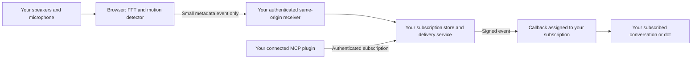

# Build your own Sonic Assistant Bridge

[日本語](build-your-own.ja.md) · [Project README](../README.md)

You can reuse the code to connect acoustic motion metadata to **your own** assistant setup. Local sensing, preview, and mock reception are available now. The authenticated delivery path is a draft integration, not a live shared service or a ready-made dot connection. See [current connection status](private-connection.md) before choosing a host.

Reuse the source and event format, not the maintainer's private infrastructure. Your receiver, verified identities, plugin, subscription, callback, and signing secret must belong to your deployment. No shared KG-NINJA private endpoint, Site ID, user ID, callback, or credential is provided by this repository.

## 1. Start with the local demo

From a source checkout, with Node.js 22+ and npm:

```sh
npm ci
npm start
```

Open `http://127.0.0.1:8765` and choose **Start demo**. It needs no microphone, speaker output, account, or API key. The development UI is Japanese; the static build includes English. `npm run demo:bridge` also checks generated events through a temporary loopback receiver without contacting an assistant.

For a local mock receiver, start with `BRIDGE_RECEIVER=1 npm start`, then select and explicitly enable the local mock destination in section 04. In PowerShell, set `$env:BRIDGE_RECEIVER='1'` before `npm start`. This remains local mock reception; it does not subscribe a dot.

To try physical sensing, click **Start microphone sensing** and use the browser's microphone permission. The page emits a high-frequency tone: default 20 kHz, 2% digital amplitude, capped at 3%. These values do not measure sound pressure or establish safety; stop if audible or uncomfortable. **Stop**, hiding the page, or leaving it ends sensing. It never starts on page load or automatically resumes. Delivery starts disabled and has its own disable control.

## 2. Keep the audio local



The diagram is the intended private deployment, not a description of an active service. Public Pages provides browser preview; it has no receiver backend and does not POST to somebody else's private site. Open your own private site's capture page to use its same-origin receiver.

The versioned JSON contract in [`src/bridge.js`](../src/bridge.js) contains only:

| Fields | Meaning |
| --- | --- |
| `schemaVersion`, `source` | Version `1`; sensor source remains `sonic-forcefield`. |
| `id`, `sessionId`, `sequence`, `occurredAt` | Temporary event/session IDs, sequence, UTC occurrence time. |
| `mode` | `live` or explicitly `synthetic`. |
| `type`, `state`, `reason` | Session lifecycle or a motion candidate and its bounded reason. |
| `score` | `null` for lifecycle; otherwise dB value, unit, and baseline/attenuation basis. |

Use the exported validator/schema; do not add audio, FFT arrays, transcripts, arbitrary text, identities, or destination URLs. Scores are neither probability nor distance. Metadata timestamps can still reveal activity. No motion does not establish absence, and detections do not establish identity or stationary presence. Physical accuracy remains hardware- and environment-dependent and unverified here.

## 3. Supply your own private deployment

1. Choose the private audience, host, sign-in route, storage, retention, and outbound transport for your deployment. Obtain the relevant owner's authorization before creating resources, connections, subscriptions, secrets, or billable services. Review the provider's current prices and limits; this guide does not promise free hosting or operation.
2. Authenticate both the capture page and its API. The server must derive `{siteId, userId}` from verified identity, not event JSON, URL parameters, or a client-chosen header. Browser microphone permission, website sign-in, plugin access, event subscription, and hosting expenditure are separate permissions.
3. Assemble the service with durable, owner-isolated atomic storage. Keep signing secrets encrypted and server-only. Implement expiry, revocation, duplicate/rate limits, and coordination between unsubscribe and outgoing connections across all workers. The test memory store cannot become production storage by changing a flag.
4. Serve the capture UI and fixed `/api/bridge/*` routes on your exact HTTPS origin. Inject `data-private-bridge="true"` only into the authenticated private page. This marker reveals controls; it grants no authorization. Never ship the loopback test marker or a browser bypass token. The draft server routes are not mounted by `npm start`.
5. Connect **your own** authenticated MCP server through **your own** plugin. Discover `sonic.motion`, request a subscription for your chosen conversation, and verify the supplied callback before enabling delivery. Callback URLs and signing secrets originate in the authenticated subscription flow; do not invent a dot endpoint or copy another person's subscription. The official flow uses `events/list`, `events/subscribe`, and `events/unsubscribe`. [OpenAI MCP Events](https://developers.openai.com/plugins/build/mcp-events)

The private UI checks status only when you click **Check authentication and subscription**. Sending stays off until you explicitly enable it after authentication, subscription, and delivery readiness pass. **Disable sending** stops this page's delivery; **Unsubscribe** separately removes the subscription. Hidden/pagehide aborts pending work and prevents background replay. An interrupted write may already have reached the server, so an uncertain outcome is not blindly retried.

## 4. Node and Sites require different integration work

For an authenticated Node host, the assembly looks like this. **This is a sketch, not a runnable deployment:** you must implement the named authentication/storage dependencies, HTTPS hosting, private HTML serving, and your framework's `Request`/`Response` adapter.

```js
import { createEventService } from './bridge/service.js';
import { createPinnedCallbackTransport } from './bridge/https-callback.js';
import { createPrivateBridgeHandler } from './bridge/private-handler.js';

const service = createEventService({
  store: yourVerifiedDurableStore,
  transport: createPinnedCallbackTransport(),
});
const handle = createPrivateBridgeHandler({
  siteOrigin: yourVerifiedHttpsOrigin,
  service,
  authenticate: verifyYourOwnSession,
});
// verifyYourOwnSession returns a verified { siteId, userId }, or null.
// Mount handle for the documented private routes; do not expose a raw identity header.
```

The Node transport checks DNS answers on each connection and pins an allowed public IPv4 address while preserving TLS hostname verification. It rejects redirects, nonpublic addresses, and IPv6/mixed-address destinations. If your callback is incompatible, keep delivery blocked until you have an equivalently protected transport.

For **Sites**, use only your own returned Site identity, private audience, and plugin. The Sites adapter trusts a verified identity header only behind Sites Dispatch; using it on a publicly reachable Node server would allow spoofing. This Node transport is not a Sites Worker implementation. A DNS precheck followed by ordinary `fetch` does not establish connection-time IP protection; `resolveOverride` is not arbitrary callback IP pinning. This repository has no verified live Sites transport, production store, or confirmed Sites Events discovery. Keep real sending off while those requirements remain unresolved. See [connection constraints](private-connection.md) and [Cloudflare Request options](https://developers.cloudflare.com/workers/runtime-apis/request/).

## 5. Verify each stage separately

| Evidence | What it establishes |
| --- | --- |
| `npm test`, `demo:bridge`, browser fixtures | Local contracts, controls, mock reception, or simulated API behavior. |
| Fake microphone test | Browser media lifecycle with synthetic input; no physical sensing accuracy. |
| Signed challenge and callback HTTP 2xx | Callback verification/acceptance; not dot processing or receipt. |
| Matching event ID observed in your subscribed conversation | Delivery to that conversation for that test event. |
| Repeated explicit real-hardware trials | Behavior on your tested setup; no general accuracy or safety guarantee. |

Start an end-to-end trial with one clearly labeled synthetic event and explicit `includeSynthetic` subscription permission. Lifecycle events are filtered from assistant delivery. Check the matching event ID in your own subscribed conversation, then test disable, unsubscribe, expiry, restart, duplicates, and cross-user rejection. Only afterwards consider an explicitly started physical-sensing trial. Do not publish keys, private URLs, or activity logs as test evidence.

Keep the [MIT license](../LICENSE) and [third-party notices](../THIRD_PARTY_NOTICES.md) when reusing the project. The [event guide](assistant-bridge.md), [recorded validation](validation.md), and [official MCP Events reference](https://developers.openai.com/plugins/build/mcp-events) provide the detailed contracts and verification scope. No step in this document creates or authorizes a shared hosted service.
